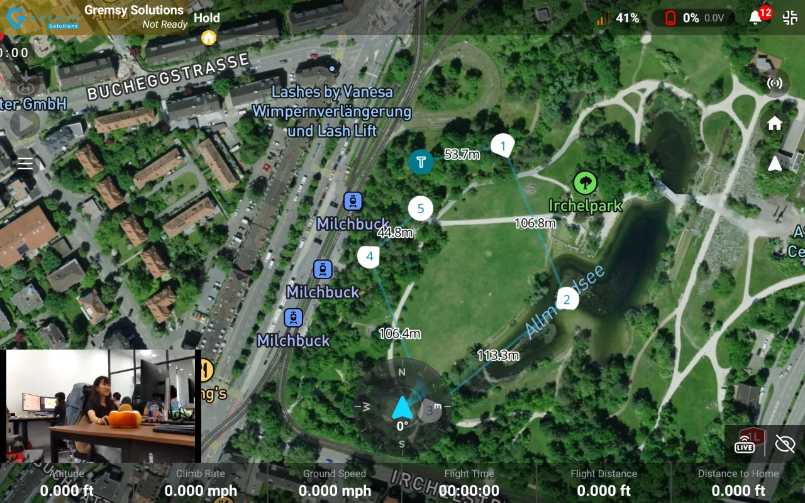
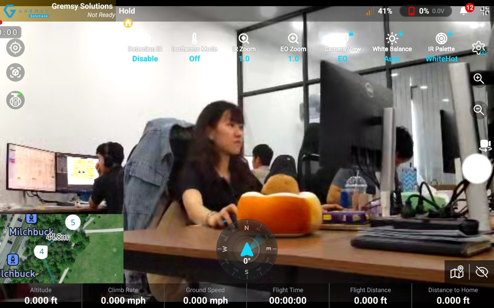
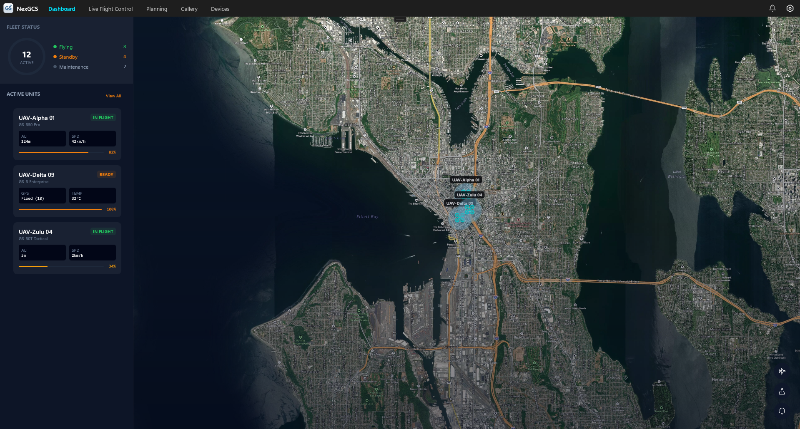
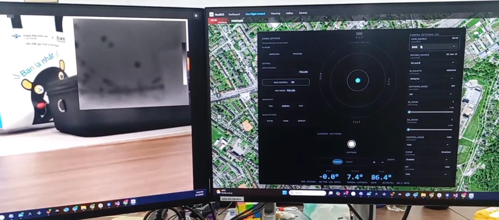

# [Gremsy Solutions / UAV Ecosystem]

**UAV Software Solutions** • **Cross-Platform GCS** • **Developer SDKs**

---

## 🚀 About us

  **Gremsy Solutions** builds the software that connects UAV payloads to the people                                                       
  flying them — from the companion computer on the aircraft to the ground control                                                         
  station in the operator's hands.                                                                                                        
                                                                                                                                          
  Our stack covers both ends of the link. **NexUNI SDK** runs on-board, driving Gremsy                                                    
  gimbal and EO/IR camera systems and publishing their capabilities to the network.                                                       
  **NexGCS** clients run on the ground, on Android and Windows. MAVLink and RTSP join                                                     
  the two — so payload control, telemetry, and live video reach the operator without                                                      
  device-specific integration work on either side.                                                                                        
                                                                                                                                          
  - 🎯 **What we build** — Ground control stations, airborne payload middleware, and the developer SDKs beneath both.                     
  - 🔗 **How it connects** — Open standards as the contract, not proprietary bridges. MAVLink and RTSP throughout, compatible with        
  ArduPilot, PX4, and third-party GCS.                                                                                                    
  - 🛰️**Where we specialize** — Real-time MAVLink telemetry, low-latency video pipelines, 3-axis gimbal stabilization, and multi-sensor  
  EO/IR payload control.                                                                                                                  
  - 🏗 **How we build it** — A shared "Base for Development" architecture: modular, documented, and meant to be extended — not just       
  consumed.                                                                
                                                                       
---

## 🛰 [NexUNI SDK](https://github.com/gremsy-solution/NexUNI-SDK)                                                                       
  **Airborne Payload Middleware for Embedded Linux**                                                                                      
                                                                                                                                          
  A C++17 static library for companion computers, sitting between your application and                                                    
  Gremsy payload hardware. It abstracts device communication, MAVLink protocol handling,                                                  
  and video pipeline management — so you write mission logic, not integration glue.                                                       
                                                                                                                                          
  **Core Capabilities:**                                                                                                                  
  - 🎯 **Gimbal Control** — 3-axis stabilization, yaw lock/follow modes, attitude via Euler angles or quaternions, real-time attitude &   
  rate telemetry, motor and parameter configuration                                                                                       
  - 📷 **Camera Management** — multi-sensor EO + thermal IR, photo capture and video recording, zoom, white balance / ISO / exposure,     
  internal & SD storage, live EO ↔ IR source switching                                                                                    
  - 📡 **Video Streaming** — GStreamer pipeline, RTSP transmission, multi-source compositing, HDMI output, microSD recording, raw stream  
  access for AI/CV workloads                                                                                                              
  - 🔌 **Flight Controller Integration** — bidirectional MAVLink with ArduPilot, PX4, and other compliant autopilots, plus parameter      
  server, FTP server, and component metadata for GCS discovery                                                                            
                                                                                                                                          
  **Built For:** autonomous missions · aerial surveillance & inspection · search and rescue                                               
  with thermal imaging · mapping and survey · custom payload integration  

  **Supported Hardware:** NexUNI-1 companion computer · Gremsy Lynx payload system                                                        
                                                                                                                                          
  **Tech Stack:** 
  
                  
                                  
     

  
## 📱 NexGCS

<table>
<tr>
<td width="50%" valign="top">

### [Mobile NexGCS](https://github.com/GremsySolutions/Mobile-NexGCS)
**Android Ground Control Station**

A comprehensive, high-performance GCS application optimized for Android devices. Designed for field operations, it handles real-time telemetry rendering and complex mission planning on the go.

**Key Features:**
- 📹 Hardware-accelerated video streaming
- ✅ Touch-optimized interface for field operations
- 🗺️ Advanced mobile map integrations and geofencing
- 📱 Real-time MAVLink data parsing and transfer
- 🔋 Optimized for battery and resource efficiency

  

  
  

</td>
<td width="50%" valign="top">

### [Windows NexGCS](https://github.com/gremsy-solution/NexGCS-Windows)
**Desktop Ground Control Station**

A robust desktop client built to leverage maximum hardware performance for complex mission monitoring, low-latency video streaming, and detailed telemetry analysis.

**Key Features:**
- 📹 Hardware-accelerated video streaming with DirectX
- 📊 Expanded UI for multi-monitor mission control
- ⚡ High-performance desktop data processing
- 🔌 Direct hardware-to-software protocol integration

  

  
  

</td>
</tr>
</table>

**Tech Stack:**

---

### 📦 [NexGCS-SDK](https://github.com/gremsy-solution/NexGCS-SDK)
**Base Development SDK for GCS**

The core software development kit powering our client applications and empowering developers to build, extend, and customize their own GCS solutions. It provides the essential building blocks, database structuring, and connection protocols for UAV communication.

**Key Features:**
- 🧩 Standardized "Base for Development" architecture across platforms
- 🔄 Pre-built modules for connection management and isolated device profiles
- 🛡️ Built-in compliance with strict software and linting standards
- 📚 Comprehensive APIs for custom payload integrations

**Tech Stack:** 

**Core Systems & Protocols**

---

## 🤝 Getting Started & Contributing

We welcome contributions from the UAV and software development communities! If you are interested in building with NexGCS or improving our SDK, please check out our repository guidelines.

- 📖 **Documentation**: [Base for Developers — Ground Control Systems](https://gremsysolutions.gitbook.io/gremsy-solutions-documentation/base-for-developers/ground-control-systems)
- 🐛 **Issue Tracker**: Please use the respective repository's Issues tab to report bugs or request features.
- 💬 **Community/Support**: 

**[Website](https://your-website.com)** • **[Documentation](https://gremsysolutions.gitbook.io/gremsy-solutions-documentation/base-for-developers/ground-control-systems)** • **[Contact Us](mailto:contact@your-org.com)**

