

# [Gremsy Solutions / UAV Ecosystem]

**UAV Software Solutions** • **Cross-Platform GCS** • **Developer SDKs**

---

## 🚀 About us

  **Gremsy Solutions** builds the software that connects UAV payloads to the people                                                       
  flying them — from the companion computer on the aircraft to the ground control                                                         
  station in the operator's hands.                                                                                                        
                                                                                                                                          
  Our stack covers both ends of the link. **NexUNI SDK** runs on-board, driving Gremsy                                                    
  gimbal and EO/IR camera systems and publishing their capabilities to the network.                                                       
  **NexGCS** clients run on the ground, on Android and Windows. MAVLink and RTSP join                                                     
  the two — so payload control, telemetry, and live video reach the operator without                                                      
  device-specific integration work on either side.                                                                                        
                                                                                                                                          
  - 🎯 **What we build** — Ground control stations, airborne payload middleware, and the developer SDKs beneath both.                     
  - 🔗 **How it connects** — Open standards as the contract, not proprietary bridges. MAVLink and RTSP throughout, compatible with        
  ArduPilot, PX4, and third-party GCS.                                                                                                    
  - 🛰️**Where we specialize** — Real-time MAVLink telemetry, low-latency video pipelines, 3-axis gimbal stabilization, and multi-sensor  
  EO/IR payload control.                                                                                                                  
  - 🏗 **How we build it** — A shared "Base for Development" architecture: modular, documented, and meant to be extended — not just       
  consumed.                                                                
                                                                       
---

## 🛰 [NexUNI SDK](https://github.com/gremsy-solution/NexUNI-SDK)                                                                       
  **Airborne Payload Middleware for Embedded Linux**                                                                                      
                                                                                                                                          
  A C++17 static library for companion computers, sitting between your application and                                                    
  Gremsy payload hardware. It abstracts device communication, MAVLink protocol handling,                                                  
  and video pipeline management — so you write mission logic, not integration glue.                                                       
                                                                                                                                          
  **Core Capabilities:**                                                                                                                  
  - 🎯 **Gimbal Control** — 3-axis stabilization, yaw lock/follow modes, attitude via Euler angles or quaternions, real-time attitude &   
  rate telemetry, motor and parameter configuration                                                                                       
  - 📷 **Camera Management** — multi-sensor EO + thermal IR, photo capture and video recording, zoom, white balance / ISO / exposure,     
  internal & SD storage, live EO ↔ IR source switching                                                                                    
  - 📡 **Video Streaming** — GStreamer pipeline, RTSP transmission, multi-source compositing, HDMI output, microSD recording, raw stream  
  access for AI/CV workloads                                                                                                              
  - 🔌 **Flight Controller Integration** — bidirectional MAVLink with ArduPilot, PX4, and other compliant autopilots, plus parameter      
  server, FTP server, and component metadata for GCS discovery                                                                            
                                                                                                                                          
  **Built For:** autonomous missions · aerial surveillance & inspection · search and rescue                                               
  with thermal imaging · mapping and survey · custom payload integration  

  **Supported Hardware:** NexUNI-1 companion computer · Gremsy Lynx payload system                                                        
                                                                                                                                          
  **Tech Stack:** 
  
                  
                                  
     

  
## 📱 NexGCS

### 📱 [Mobile NexGCS](https://github.com/GremsySolutions/Mobile-NexGCS)
**Android Ground Control Station**

A comprehensive, high-performance GCS application optimized for Android devices. Designed for field operations, it handles real-time telemetry rendering and complex mission planning on the go.

**Key Features:**
- 📹 Hardware-accelerated video streaming
- ✅ Touch-optimized interface for field operations
- 🗺️ Advanced mobile map integrations and geofencing
- 📱 Real-time MAVLink data parsing and transfer
- 🔋 Optimized for battery and resource efficiency

**Tech Stack:**  

 

  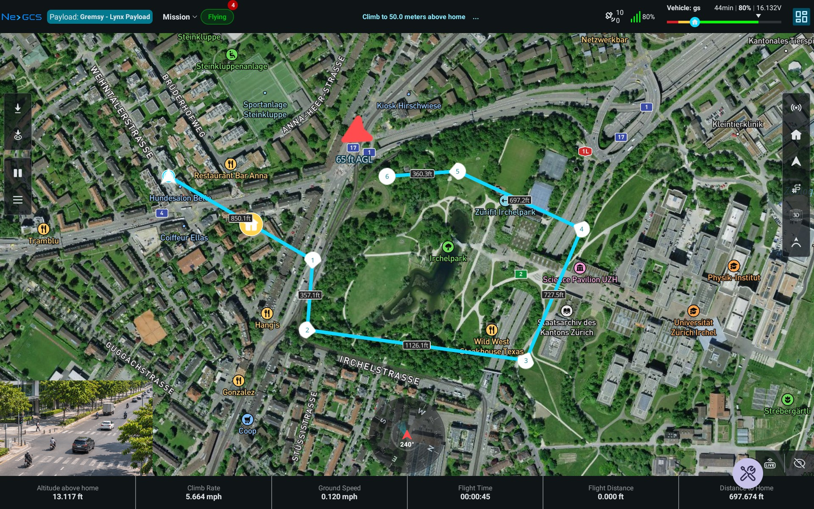
  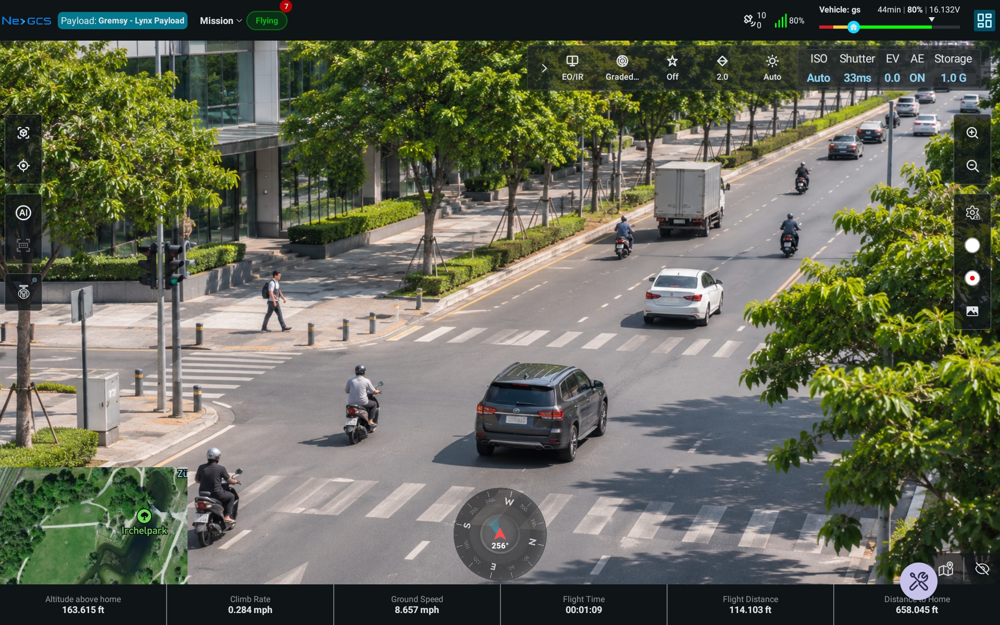

---

### 💻 [Windows NexGCS](https://github.com/gremsy-solution/NexGCS-Windows)
**Desktop Ground Control Station**

A robust desktop client built to leverage maximum hardware performance for complex mission monitoring, low-latency video streaming, and detailed telemetry analysis.

**Key Features:**
- 📹 Hardware-accelerated video streaming with DirectX
- 📊 Expanded UI for multi-monitor mission control
- ⚡ High-performance desktop data processing
- 🔌 Direct hardware-to-software protocol integration

**Tech Stack:**  

#### 1. Multi-Monitor
On desktop, NexGCS can pop key views out into separate windows that can be moved and resized independently — including onto a second monitor — while the main window keeps the map and the full flight HUD (altitude, speed, attitude, battery, GPS, flight mode):

- **Live Video**: the real-time camera stream in its own resizable window, so the map and the video can be watched side by side.
- **Camera & Payload**: camera status (exposure, recording, storage, stream state), gimbal control with an on-screen joystick, and camera settings in one panel.
- **System Information**: sensor health and a live feed of vehicle and system messages, with an unread-message counter.
- **Preflight Check**: the preflight checklist, open beside the map rather than covering it.
- **Vehicle Settings & Parameters**: vehicle configuration and parameter editing, without leaving the flight view.
  

    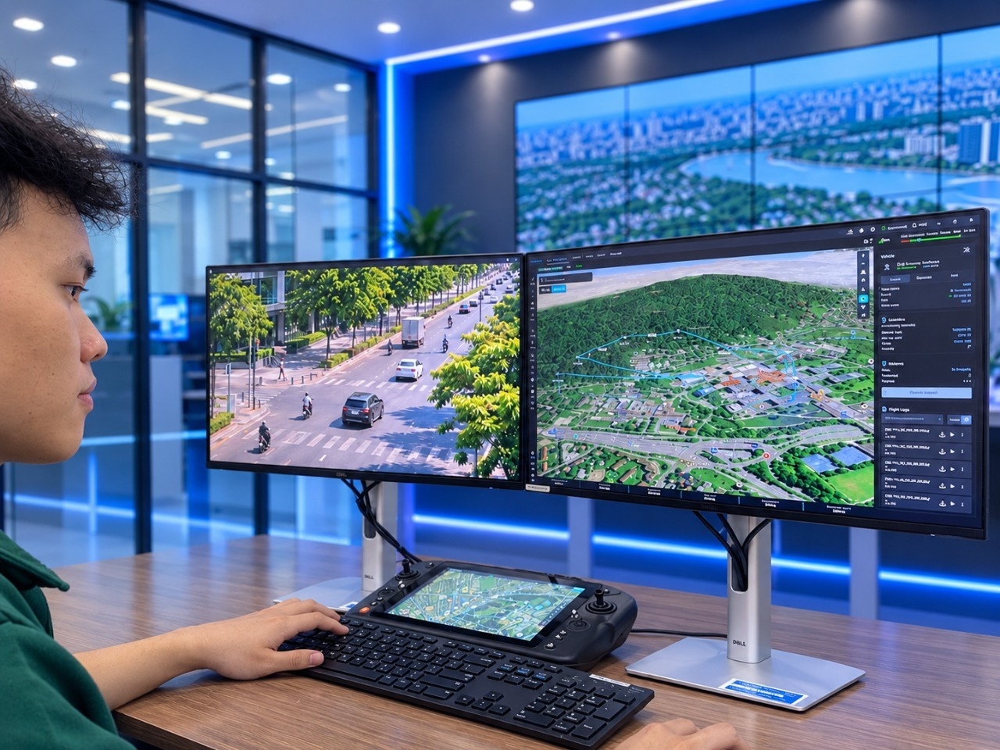
  

#### 2. Flight View Layout
The desktop flight screen is split into five fixed regions, so the map or video is never covered by controls:

- **Status Bar** (top): payload, flight mode and flight status, centre notifications, and link health at a glance — GPS, RC/telemetry signal, Remote ID, and battery. Clicking the flight status opens the System Information window.
- **Control Rail** (left): flight commands — Takeoff/Land, RTL, Mission start/pause, and quick actions (altitude, loiter radius); payload shortcuts — zoom, photo, record, object tracking and detection, camera settings; and view controls — swap map/video, corner widget, and picture-in-picture.
- **Main Stage** (centre): the map or the live video, swappable at any time; in PiP mode the video moves to its own window.
- **Information Panel** (right): live cards for **Vehicle** (status, telemetry, and firmware/system info), **Location** (coordinates, MSL/AGL altitude, speed, heading), **Mission** (status, waypoint count, progress, shortcut to the planner), and **Flight Logs** (search, sort, download, replay, export). It hides automatically when the video takes over the stage.
- **Telemetry** (bottom): flight distance, ground speed, distance to home, climb rate, altitude above home, and flight time.
    
  

    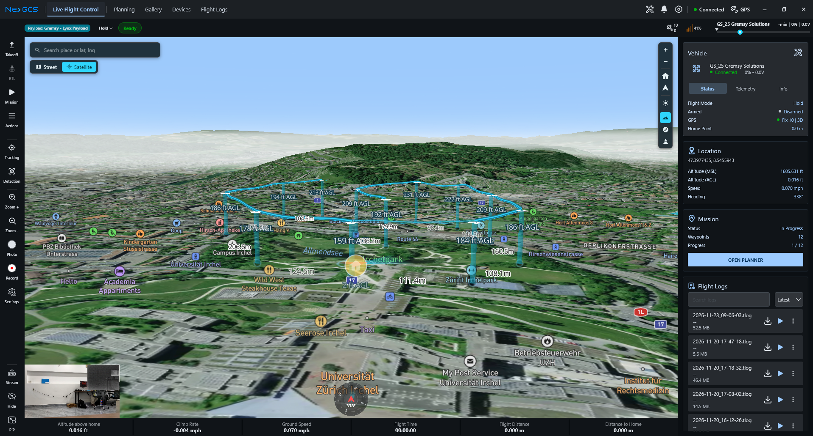
  

#### 3. Camera Settings
A dedicated, movable window brings camera configuration, live camera status, and gimbal control together in one place:

- **Camera Info & Parameters**: live readings of ISO, shutter speed, exposure (EV / AE), resolution, frame rate, and zoom — editable directly where the camera supports it — plus recording time, stream status, and storage usage with low-space warnings.
- **Camera Settings**: every parameter the connected camera reports (via the MAVLink camera definition) is listed and adjustable, so options such as white balance or colour mode appear automatically for cameras that offer them.
- **Capture**: photo capture and video recording, with zoom in/out.
- **Gimbal Control**: an on-screen joystick for smooth rate-based pointing, live pitch/roll/yaw readout with a heading dial, Yaw Follow / Yaw Lock, mount mode selection, and one-tap Centre, Tilt 90° and Retract. A Take/Release Control flow prevents conflicts when another ground station is driving the gimbal.
- **AI Assist**: object tracking and object detection modes, with live target status (searching, target locked, detecting).
- **RC Mapping**: view and change which RC channels and AUX functions drive the mount.
  On Gremsy VIO payloads this includes switching the stream between the optical (EO) and thermal (IR) camera.
  
  

    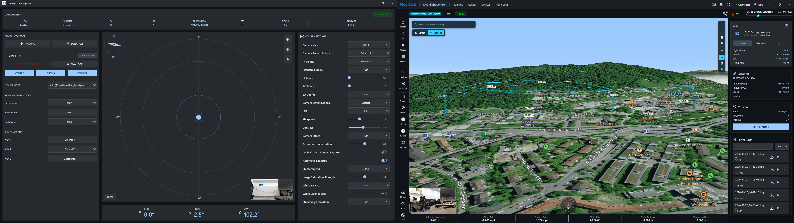
  

#### 4. Mission Planning
Plan, configure, save and upload autonomous missions from an interactive map, with live distance, time and terrain feedback while you edit.
- **Mission Library**: every mission is saved as a `.kmz` file with a map thumbnail. Search, filter by type, preview stats (distance, time, max altitude, average speed, waypoints), import, edit, duplicate, delete, and upload to the vehicle in one click.

- **Waypoint Missions**: place Home, Takeoff and waypoints directly on the map, then fine-tune each point — latitude, longitude, altitude and flight speed. Every waypoint can carry its own payload actions: 
  - *Camera*: take a photo, start/stop timed or distance-based photo capture, start/stop video, and switch camera mode. 
  - *Gimbal*: set pitch and yaw for the shot.

Choose the end-of-mission behaviour (Return to Launch or none) and check the route against a terrain elevation profile before flight.
- **Survey Mapping**: draw the area to cover and NexGCS generates a parallel-line (lawnmower) grid. Set the camera from its sensor and lens specifications, choose altitude or target GSD, line angle, spacing and entry corner, and pick the capture method — continuous Distance Trigger or Hover & Capture with a hold delay. Area, line count, distance and flight time update live.
- **Corridor & Structure Scans** *(Android)*: linear corridor and structure-inspection mission templates.
  

  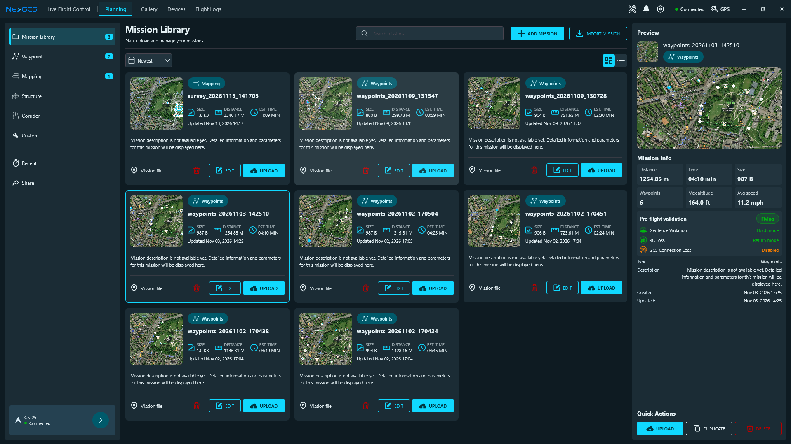
  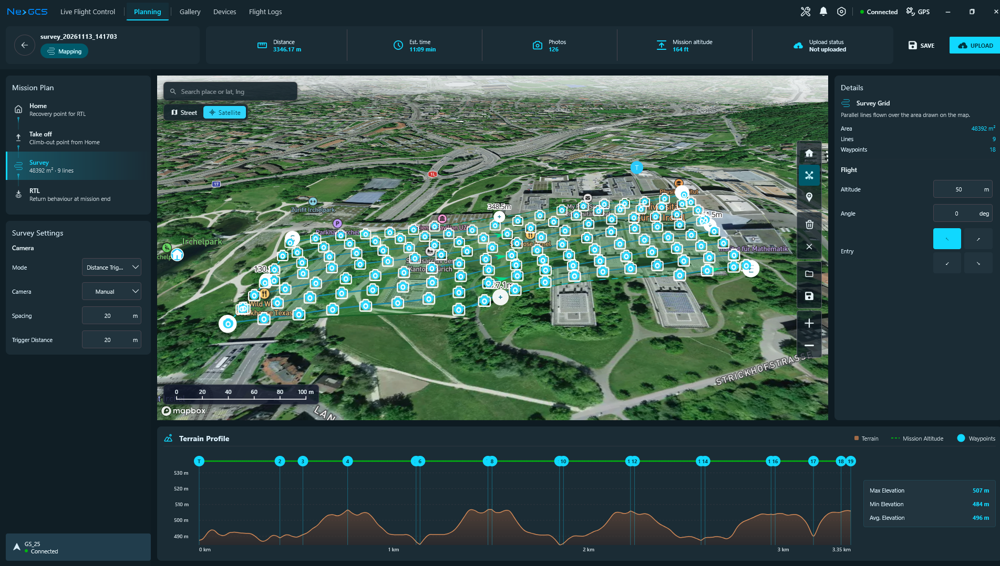
  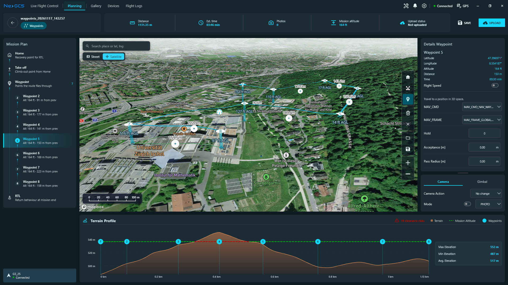

#### 5. Flight Log
Automatic telemetry recording with full flight replay, so any past flight can be reviewed exactly as it was flown.

- **Automatic Recording**: every live vehicle connection is recorded to a standard MAVLink telemetry log (`.tlog`), with no operator action needed. Older logs are rotated out automatically so recording never fills the disk.
- **Flight Replay**: play any log back on the flight screen — the vehicle, its track and its telemetry move as they did in the air — with play/pause, seek and playback-speed control. NexGCS warns before starting a replay while a real vehicle is armed.
- **Log Management**: a searchable, sortable log table showing date, duration and size; open external `.tlog` files; download/export, show in folder, rename and delete; storage usage at a glance.
- **Quick Access**: the newest logs are also listed in the flight view's information panel for one-click replay.
  

  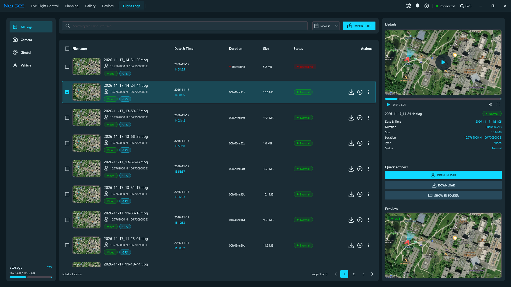

#### 6. DevTools
A built-in log viewer that shows what the application and the vehicle link are doing in real time, so issues can be diagnosed in the field without extra tools.

- **Live Log Table**: every log entry with time, level, source tag and message, updating as it happens, with auto-scroll to follow the newest entries.
- **Level Filtering**: show or hide Debug, Info, Warning and Error entries with one click.
- **Filter by Module**: logs are grouped by the part of the app that wrote them, each with its own count, so you can focus on a single subsystem.
- **Search**: find entries by text across the whole log.
- **Statistics & Connection**: total log count and per-type counts, plus the live vehicle connection status beside the log.
- **View Options**: toggle timestamps and auto-scroll; clear the log (with confirmation).
  

  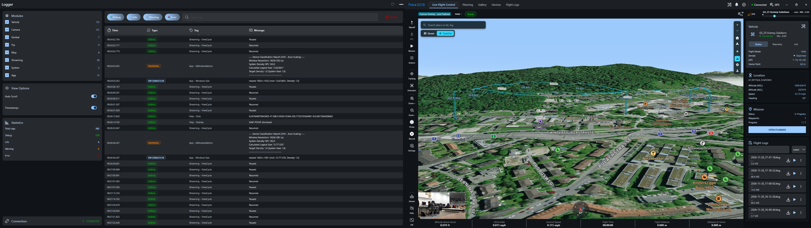

#### 7. Parameters
A dedicated parameter window for viewing and tuning every onboard parameter — the autopilot first, then any other component that exposes parameters, such as a gimbal or camera.

- **Browse & Search**: parameters are organised by category and group, with counts, and a search bar suggests matches as you type.
- **Safe Editing**: each parameter opens an editor showing its description, valid range, default value and units; changes are written to the vehicle immediately on save.
- **Backup & Restore**: save the full parameter set to a `.param` file and load it back, for backups or for cloning a configuration across vehicles.
- **Reset & Reboot**: refresh from the vehicle, reset to firmware defaults or to the vehicle's stored configuration, and reboot the vehicle so changes take effect.
- **RC To Param**: bind an RC channel to a parameter so it can be tuned in flight from the transmitter, with configurable min, max, centre and scale.
  

  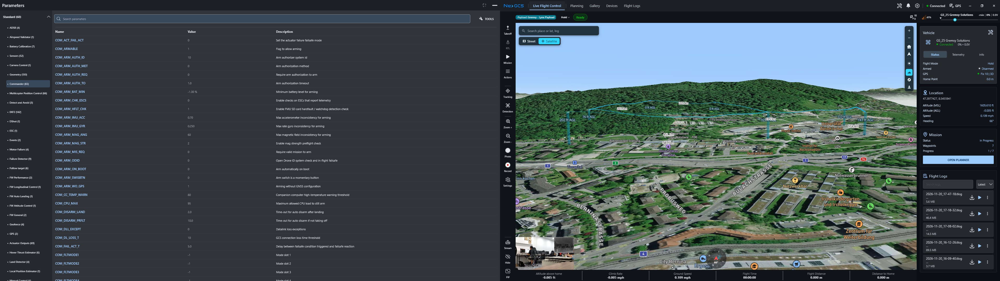

---

### 📦 [NexGCS-SDK](https://github.com/gremsy-solution/NexGCS-SDK)
**Base Development SDK for GCS**

The core software development kit powering our client applications and empowering developers to build, extend, and customize their own GCS solutions. It provides the essential building blocks, database structuring, and connection protocols for UAV communication.

**Key Features:**
- 🧩 Standardized "Base for Development" architecture across platforms
- 🔄 Pre-built modules for connection management and isolated device profiles
- 🛡️ Built-in compliance with strict software and linting standards
- 📚 Comprehensive APIs for custom payload integrations

**Tech Stack:** 

**Core Systems & Protocols**

---

## 🤝 Getting Started & Contributing

We welcome contributions from the UAV and software development communities! If you are interested in building with NexGCS or improving our SDK, please check out our repository guidelines.

- 📖 **Documentation**: [Base for Developers — Ground Control Systems](https://gremsysolutions.gitbook.io/gremsy-solutions-documentation/base-for-developers/ground-control-systems)
- 🐛 **Issue Tracker**: Please use the respective repository's Issues tab to report bugs or request features.
- 💬 **Community/Support**: 

**[Website](https://your-website.com)** • **[Documentation](https://gremsysolutions.gitbook.io/gremsy-solutions-documentation/base-for-developers/ground-control-systems)** • **[Contact Us](mailto:contact@your-org.com)**

